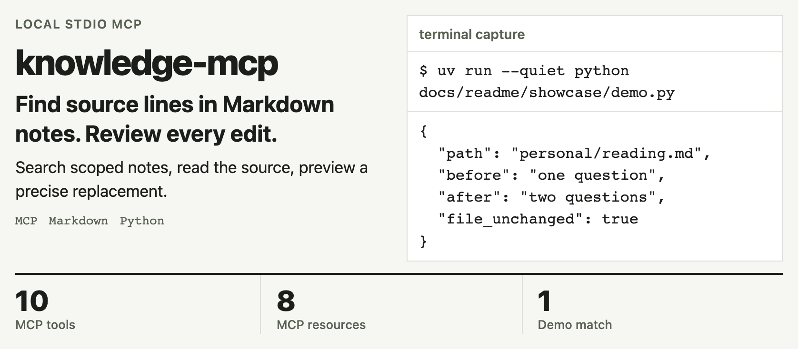
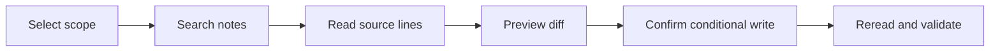

<!-- readme-from-code:banner:hero:start -->
<h1><picture>
  <source media="(prefers-color-scheme: dark)" srcset="docs/readme/hero-dark.png">
  
</picture></h1>
<p><em>Real stdio MCP search and diff on bundled synthetic notes, 2026-11-11; no note writes. <code>uv run --quiet python docs/readme/showcase/demo.py</code></em></p>
<!-- readme-from-code:banner:hero:end -->

[中文](README.md) · [Quick start](#quick-start) · [Features](#features) · [Full reference](docs/REFERENCE.en.md)

```sh
uvx --from git+https://github.com/bmdy6/knowledge-mcp knowledge-mcp --vault /absolute/path/to/vault
```

For knowledge-vault maintainers who want AI-assisted organization with checkable sources. Markdown stays readable and editable; MCP supplies search and guarded maintenance.

## Why use it

| By hand | With knowledge-mcp |
| --- | --- |
| Find a keyword, then open the file | Get paths, source lines and snippets together |
| Ask an agent to rewrite a whole file | Preview a local replacement before deciding to write |
| Search unrelated notes together | Explicitly select personal or company on every call |

## Features

| Find the evidence | Review the change |
| --- | --- |
| **Keyword search**: Chinese bigrams and BM25 return traceable snippets. | **Preview the diff**: show_diff shows the replacement without writing notes. |
| **Exact source lines**: read_range returns the requested lines for checking. | **Conditional writes**: expected_text must match the current file exactly once. |
| **Visible partial results**: healthy hits survive malformed notes, with a separate warning. | **Scope and archive guards**: paths stay inside the vault; archives cannot be edited directly. |

## See it work

The [replayable demo](docs/readme/showcase/demo.py) lists **10 tools and 8 resources** over real MCP. Searching synthetic notes for question returns **1 note**, reads **lines 14–18** of `personal/reading.md`, previews a replacement and verifies the file SHA is unchanged.

The banner shows that search location and unchanged-file status. It is a keyword lookup, with no generated answer.

## Quick start

Requires Python 3.10+, [uv](https://docs.astral.sh/uv/) and network access for the first download.


Replace `/absolute/path/to/vault` with an existing vault directory. To try synthetic notes, [download the repository ZIP](https://github.com/bmdy6/knowledge-mcp/archive/refs/heads/main.zip) and select `examples/vault`.
Connect a client, then ask: “Search personal for question; return paths, line numbers and snippets.” [Three client configurations](docs/REFERENCE.en.md#client-configuration) remain in the reference.

## How it works



The server routes MCP calls into Vault's path and text checks. Writes use a local cross-process lock; maintainers handle history and Git commits.

## Built to be trusted

- This run of `uv run pytest -q`: **69 passed**, covering stdio, search, resources, path boundaries and concurrent writes.
- CI is configured for Ubuntu, macOS, Windows and Python 3.10/3.13. This run tested macOS locally.
- Notes remain Markdown; search requires no embedding service. The MCP client's own data transfers depend on its configuration.

## FAQ and limits

**Is search semantic?** It is keyword based, without vectors. People must still check the results.

**Are scopes an access-control system?** They separate documents and do not replace operating-system permissions. Archives are excluded by default.

**Does the write lock cover editors?** MCP processes wait at most 10 seconds for the lock. Editors and sync tools do not honor it; network filesystems are unverified.

**What happens to malformed notes?** Healthy matches remain, followed by `{warning, partial: true, skipped}`. A diagnostic is separate from a match.

## Contributing

Open an Issue and run `uv run pytest -q` during development. See [tools, options, content model and write boundaries](docs/REFERENCE.en.md) and [image reproduction](docs/readme/SOURCES.md).

## License

[MIT](LICENSE). Star the project if source-backed note maintenance is useful to you.
