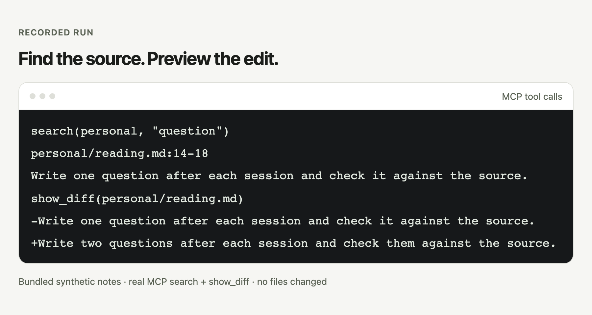

# knowledge-mcp

Search Markdown notes with source lines and preview edits through a scoped MCP server.

[中文](README.md)

<picture>
  <source media="(prefers-color-scheme: dark)" srcset="docs/images/en/hero-dark.png">
  
</picture>

Real MCP output from bundled synthetic notes; the diff shows changed lines only and writes no files.

## Quick start

```sh
uvx --from git+https://github.com/bmdy6/knowledge-mcp knowledge-mcp --vault <路径>
```

Replace `<路径>` with your existing vault’s absolute path. To try the synthetic example, [download the main ZIP](https://github.com/bmdy6/knowledge-mcp/archive/refs/heads/main.zip), extract it, and select `examples/vault`; no clone is required.
Connect a client, then ask: “Search personal for question; return paths, line numbers and snippets.” Requires Python 3.10+, [uv](https://docs.astral.sh/uv/getting-started/installation/), and network access for the first download.

## Client configuration

For a trial, copy the download’s `examples/vault` to `/tmp/knowledge-mcp-demo`. All three configurations use this directory; replace it with your own absolute path for ongoing use, then restart the client.
`uvx` must be on the client’s PATH; the first download can take longer.

### Claude Code

Save as your project’s `.mcp.json`:

```json
{
  "mcpServers": {
    "knowledge": {
      "command": "uvx",
      "args": [
        "--from",
        "git+https://github.com/bmdy6/knowledge-mcp",
        "knowledge-mcp",
        "--vault",
        "/tmp/knowledge-mcp-demo"
      ]
    }
  }
}
```

### Codex

Add to `~/.codex/config.toml`:

```toml
[mcp_servers.knowledge]
command = "uvx"
args = ["--from", "git+https://github.com/bmdy6/knowledge-mcp", "knowledge-mcp", "--vault", "/tmp/knowledge-mcp-demo"]
startup_timeout_sec = 60
```

### Cursor

Save as your project’s `.cursor/mcp.json`:

```json
{
  "mcpServers": {
    "knowledge": {
      "command": "uvx",
      "args": [
        "--from",
        "git+https://github.com/bmdy6/knowledge-mcp",
        "knowledge-mcp",
        "--vault",
        "/tmp/knowledge-mcp-demo"
      ]
    }
  }
}
```

Read `knowledge://guide` after connecting. See the [client guide](docs/CLIENT_CONFIG.md) for settings and paths.

## What you get

- Search results include paths, line numbers and source snippets for checking the original.
- `show_diff` previews edits; writes require `expected_text` to match the current file exactly once.
- Explicit scopes and path checks keep document operations within the vault.

## How it works

1. Search `personal` or `company`, then read the source with `read_range`.
2. Supply the original text and replacement; review `show_diff`.
3. Confirm, call `apply_change`, reread and validate; maintainers handle Git commits.

## Tools

| Access | Tools |
| --- | --- |
| Read only | `search`, `list_documents`, `read`, `read_range`, `show_diff`, `validate_vault` |
| Writes | `create_document`, `apply_change`, `move_document`, `delete_document` |

See the [MCP contract](docs/MCP_CONTRACT.md) for arguments. New documents start as `review`; deletion, merging and moving also change files.

When a note is malformed or unreadable, search returns healthy matches followed by a `{warning, partial: true, skipped}` diagnostic. Callers must distinguish records containing `warning` from matches with paths and line numbers. Even zero matches may represent an incomplete search.

## Options

| Option | Purpose |
| --- | --- |
| `--vault` / `KNOWLEDGE_VAULT` | Select an existing directory; the argument wins, and missing configuration exits. |
| `scope` | Explicitly select `personal` or `company`. |
| `include_archive` | Off by default; enable explicitly to read archived notes. |

## FAQ and boundaries

**How is a vault organized?** `personal/` and `company/` each contain Markdown notes and a `README.md` overview; `archive/` is optional. See the [content model](docs/CONTENT_MODEL.md) for frontmatter fields including `title`, `type`, `status`, `scope` and dates.

**What protects writes?** `expected_text` is a local text condition that must occur exactly once in the current file; review the diff first. Absolute paths, `..` and cross-scope document paths are rejected; archives cannot be written directly. Scopes separate documents and do not replace operating-system permissions; see [write safety](docs/WRITE_SAFETY.md).

MCP processes share a write lock per local vault on macOS/Linux/Windows, with a 10-second wait limit. The root keeps `.knowledge-mcp.lock`; do not delete it during operation, and add it to your vault's own `.gitignore` if needed. External editors and sync tools do not honor this lock; pause MCP writes while using them. Network filesystems have not been verified.

**Is search semantic?** Search is keyword based (Chinese bigrams + BM25), with no vector search or embedding service. People must still check content and search results.

## Contributing

Open an Issue describing the problem; install development dependencies and run `uv run pytest -q` locally. CI covers Ubuntu, macOS, Windows and Python 3.10 and 3.13.

## License

[MIT](LICENSE).
