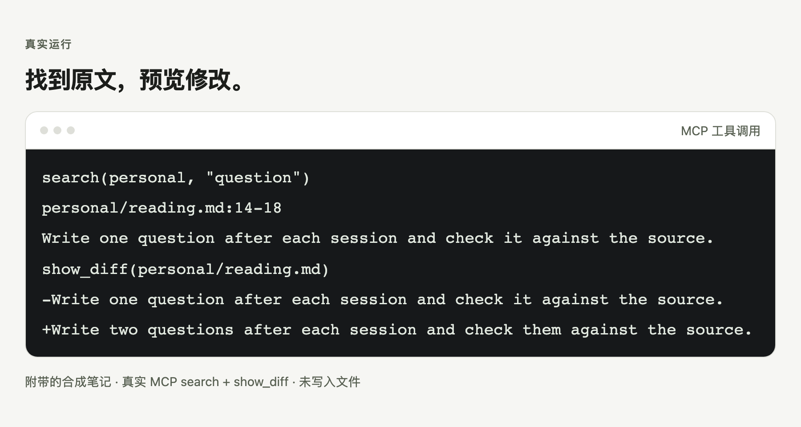

# knowledge-mcp

通过 MCP 检索 Markdown 笔记、定位原文并预览修改。

[English](README.en.md)

<picture>
  <source media="(prefers-color-scheme: dark)" srcset="docs/images/zh/hero-dark.png">
  
</picture>

合成示例库的真实 MCP 输出；图中只展示 diff 的变更行，未写入文件。

## 快速开始

```sh
uvx --from git+https://github.com/bmdy6/knowledge-mcp knowledge-mcp --vault <路径>
```

将 `<路径>` 换成已有知识库的绝对路径。先试用可[下载 main 的 ZIP](https://github.com/bmdy6/knowledge-mcp/archive/refs/heads/main.zip)，解压后选择 `examples/vault`；这是合成示例，无需 clone。
连接客户端后说：“在 personal 中搜索 question，返回路径、行号和片段。”需要 Python 3.10+、[uv](https://docs.astral.sh/uv/getting-started/installation/) 和首次下载所需的网络。

## 客户端配置

试用时，把下载包里的 `examples/vault` 复制到 `/tmp/knowledge-mcp-demo`。下面三份配置均使用该目录；长期使用请换成自己的绝对路径，重启客户端以载入配置。
`uvx` 必须在客户端的 PATH 中可用；首次下载可稍慢。

### Claude Code

保存为项目的 `.mcp.json`：

```json
{
  "mcpServers": {
    "knowledge": {
      "command": "uvx",
      "args": [
        "--from",
        "git+https://github.com/bmdy6/knowledge-mcp",
        "knowledge-mcp",
        "--vault",
        "/tmp/knowledge-mcp-demo"
      ]
    }
  }
}
```

### Codex

加入 `~/.codex/config.toml`：

```toml
[mcp_servers.knowledge]
command = "uvx"
args = ["--from", "git+https://github.com/bmdy6/knowledge-mcp", "knowledge-mcp", "--vault", "/tmp/knowledge-mcp-demo"]
startup_timeout_sec = 60
```

### Cursor

保存为项目的 `.cursor/mcp.json`：

```json
{
  "mcpServers": {
    "knowledge": {
      "command": "uvx",
      "args": [
        "--from",
        "git+https://github.com/bmdy6/knowledge-mcp",
        "knowledge-mcp",
        "--vault",
        "/tmp/knowledge-mcp-demo"
      ]
    }
  }
}
```

接入后先读 `knowledge://guide`。客户端设置与路径说明见[接入文档](docs/CLIENT_CONFIG.md)。

## 你能得到什么

- 搜索结果带文件路径、行号和原文片段，方便回到来源核实。
- `show_diff` 只预览修改；写入时 `expected_text` 必须在当前文件中唯一匹配。
- 每次访问都选定 scope，路径校验将文档操作限制在知识库内。

## 工作流程

1. 在 `personal` 或 `company` 中搜索，再用 `read_range` 读取原文。
2. 传入原文片段和替换文本，用 `show_diff` 审阅变化。
3. 确认后调用 `apply_change`，回读并校验；Git 提交由维护者处理。

## 工具

| 权限 | 工具 |
| --- | --- |
| 只读 | `search`、`list_documents`、`read`、`read_range`、`show_diff`、`validate_vault` |
| 写入 | `create_document`、`apply_change`、`move_document`、`delete_document` |

参数见 [MCP 契约](docs/MCP_CONTRACT.md)。新建文档固定为 `review`；删除、合并和移动也会改动文件。

搜索遇到损坏或不可读笔记时仍返回健康命中，并在列表末尾追加 `{warning, partial: true, skipped}`。调用方应先区分 `warning` 诊断和普通命中，不能把它当作有 `path`、行号的结果；零命中时也可能只是部分搜索。

## 选项

| 选项 | 用途 |
| --- | --- |
| `--vault` / `KNOWLEDGE_VAULT` | 指定已有目录；参数优先，未配置就退出。 |
| `scope` | 显式选择 `personal` 或 `company`。 |
| `include_archive` | 默认关闭；显式开启才读取归档。 |

## 常见问题与限制

**知识库如何组织？** `personal/`、`company/` 各放 Markdown 笔记和概览 `README.md`，可选 `archive/`。Frontmatter 的 `title`、`type`、`status`、`scope`、日期等字段见[内容模型](docs/CONTENT_MODEL.md)。

**写入有什么保护？** `expected_text` 是局部文本条件，须在当前文件恰好出现一次；先看 diff 再提交修改。绝对路径、`..` 和跨 scope 文档路径会被拒绝，归档不可直接写入；scope 是文档边界，不能替代操作系统权限。详见[写入安全](docs/WRITE_SAFETY.md)。

同一 vault 的 MCP 写入在 macOS/Linux/Windows 上使用跨进程锁，等待超过 10 秒会报告繁忙。根目录会保留 `.knowledge-mcp.lock`，运行时不要删除，可加入知识库自己的 `.gitignore`。锁不能协调外部编辑器或同步器，网络文件系统也未验证；操作这些工具时应暂停 MCP 写入。

**支持语义检索吗？** 目前只有关键词检索（中文二元组 + BM25），没有向量检索，也不需要 embedding 服务。内容和检索结果仍需人工核实。

## 参与贡献

先提 Issue 说明问题；本地安装开发依赖后运行 `uv run pytest -q`。CI 覆盖 Ubuntu、macOS、Windows 和 Python 3.10、3.13。

## 许可证

[MIT](LICENSE)。
