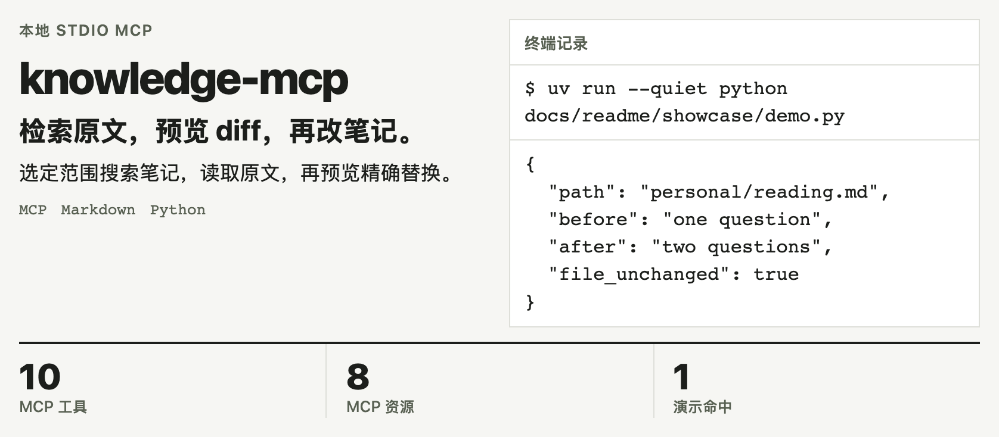

<!-- readme-from-code:banner:hero:start -->
<h1><picture>
  <source media="(prefers-color-scheme: dark)" srcset="docs/readme/hero-dark.zh-CN.png">
  
</picture></h1>
<p><em>2026-11-11，附带合成笔记上的真实 stdio MCP 搜索和 diff；未写入笔记。 <code>uv run --quiet python docs/readme/showcase/demo.py</code></em></p>
<!-- readme-from-code:banner:hero:end -->

[English](README.en.md) · [快速开始](#快速开始) · [能力](#能力) · [完整参考](docs/REFERENCE.md)

```sh
uvx --from git+https://github.com/bmdy6/knowledge-mcp knowledge-mcp --vault /absolute/path/to/vault
```

面向想让 AI 整理已有笔记、同时保留原文依据的知识库维护者。Markdown 仍由人阅读和编辑，MCP 提供检索与受保护的维护入口。

## 为什么用它

| 手动处理 | 用 knowledge-mcp |
| --- | --- |
| 搜到关键词后再翻文件 | 搜索同时返回路径、行号、原文片段 |
| 让 agent 重写整篇文件 | 先用 show_diff 看局部替换，再决定是否写入 |
| 混着检索不同用途的笔记 | 每次显式指定 personal 或 company 范围 |

## 能力

| 找到依据 | 审阅修改 |
| --- | --- |
| **关键词搜索**：中文二元组与 BM25；返回可追溯片段。 | **预览 diff**：show_diff 展示具体替换，不写笔记。 |
| **精确行号**：read_range 读取指定行，回到原文核对。 | **条件写入**：expected_text 在当前文件中必须唯一匹配。 |
| **部分结果可见**：坏笔记不吞掉健康命中，另附 warning 诊断。 | **范围与归档保护**：限制知识库内路径，归档不能直接写入。 |

## 看它运行

附带[可重放演示](docs/readme/showcase/demo.py)经真实 MCP 列出 **10 个工具、8 个资源**，搜索合成示例的 question，命中 **1 篇笔记**，读取 `personal/reading.md` 的第 **14–18 行**，预览替换并验证文件 SHA 未变。

横幅展示此次搜索的位置与未写入状态；它不是语义搜索或模型生成的答案。

## 快速开始

需要 Python 3.10+、[uv](https://docs.astral.sh/uv/) 和首次下载所需的网络。


把 `/absolute/path/to/vault` 换成已有知识库目录。先试用可下载[仓库 ZIP](https://github.com/bmdy6/knowledge-mcp/archive/refs/heads/main.zip)，选择其中的 `examples/vault`。
加入 MCP 客户端后说：“在 personal 中搜索 question，返回路径、行号和片段。”[三种客户端配置](docs/REFERENCE.md#客户端配置)保留在参考页。

## 工作流程


服务把 MCP 工具调用交给 Vault 的路径与文本检查。写入使用本地跨进程锁；版本整理和 Git 提交由维护者处理。

## 可信度

- 本次 `uv run pytest -q`：**69 passed**；覆盖 stdio、检索、资源、路径限制与并发写入。
- CI 配置覆盖 Ubuntu、macOS、Windows 以及 Python 3.10、3.13；本次只在 macOS 本地运行。
- 笔记是 Markdown；检索不需要 embedding 服务。MCP 客户端自己的数据传输由其配置决定。

## 常见问题与限制

**是语义搜索吗？** 目前是关键词检索，没有向量检索；结果仍需人工核实。

**scope 是权限系统吗？** 不是。它是文档边界，不能替代操作系统权限；默认不读归档。

**外部编辑器也受写锁保护吗？** 不受。MCP 之间的锁最多等待 10 秒；编辑器与同步器不遵守该锁，网络文件系统未验证。

**遇到损坏笔记呢？** 健康命中仍返回，末尾附 `{warning, partial: true, skipped}`；诊断不是普通命中。

## 参与贡献

先提 Issue，开发时运行 `uv run pytest -q`。[完整工具、选项、内容模型和写入边界](docs/REFERENCE.md)与[图源复现](docs/readme/SOURCES.md)可继续查阅。

## 许可证

[MIT](LICENSE)。如果这套带原文依据的维护方式对你有用，欢迎点 Star。
